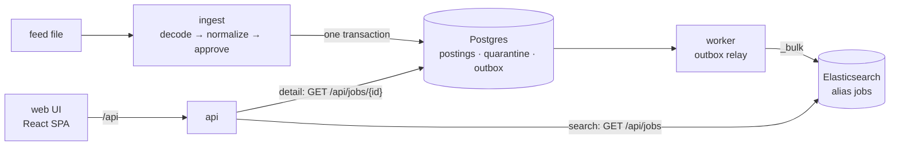

# Architecture

## System flow

Postgres is the source of truth: every posting, its decision and reasons, every quarantined
record and the outbox live there. Elasticsearch is a read model that only the worker writes
and only the API reads, so it can be rebuilt from Postgres at any time with `ingest --reindex`.
`ingest` writes a posting and its outbox row in the same transaction, so no posting is stored
without being queued for indexing and nothing is indexed that was not stored. The worker
indexes approved postings and deletes rejected ones; delivery is at least once. Once an
hour the worker also deletes outbox rows that were processed more than 7 days ago, so the
table holds only pending work and a week of history; dead-lettered rows are never processed,
so the purge leaves them in place.

The UI is a single-page app. The job list and its country facets come from Elasticsearch
(`GET /api/jobs`); the selected job's detail comes from Postgres by primary key
(`GET /api/jobs/{id}`), because the description is not in the index. Reading the detail from
the source of truth also means a job rejected after it was indexed shows as no longer
available instead of being served. The SPA reaches the API through Vite's `/api` proxy
(`vite preview` in the `web` container), so browser and API share one origin and need no CORS.

The approval decision is a pure function of the posting, the policy, the exchange rates and
the language detector, so every decision can be tested and explained without a database.

How malformed input is handled, and which package does what, is in the
[backend README](../backend/README.md#input-handling).

## Known limitations

- **Postings are never retracted.** A job that drops out of a later feed, or comes back with
  an edited title (a new identity), leaves the old posting approved and searchable. The fix is
  a per-source snapshot run that marks postings missing from the latest full feed as `expired`
  and enqueues them for deletion, plus a time-to-live on `posted_on`.
- **Dead-lettered outbox rows stay dead.** After 5 failed indexing attempts a row is set aside
  and nothing retries it; `ingest --reindex` re-enqueues every posting.
- **Feeds are not streamed**; see [input handling](../backend/README.md#input-handling).
- **The same job from two sources is listed twice**; see
  [duplicates across sources](decisions.md#duplicates-across-sources).

## Production path

Not built; this is what would change for production:

- **Live exchange rates** behind the same rate interface, plus a `reevaluate` command that
  re-runs the policy over stored postings after a policy or rate change, with decision history
  and a tolerance band so small rate moves don't flip decisions.
- **Reindexing without downtime:** build a new index, replay the outbox into it, then swap the
  `jobs` alias atomically.
- **Change data capture** (Debezium → Kafka) instead of polling the outbox table.
- **OpenTelemetry tracing and metrics** across ingest, worker and API.
- **Static hosting for the UI:** `vite preview` is not a production server. The built `dist/`
  would sit on a CDN or object storage, with the load balancer routing `/api` to the API
  instances, which keeps the single origin.
