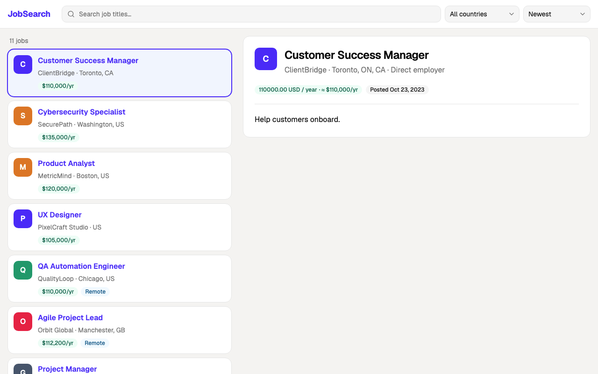
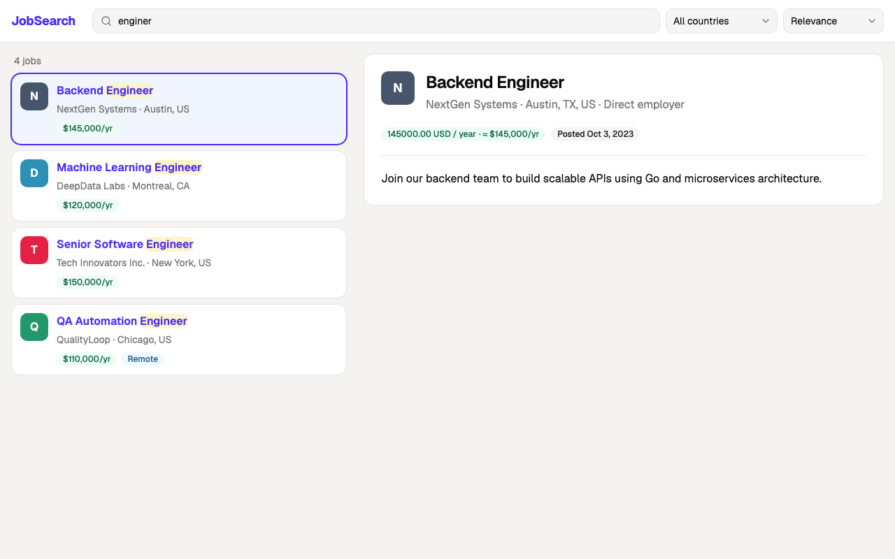
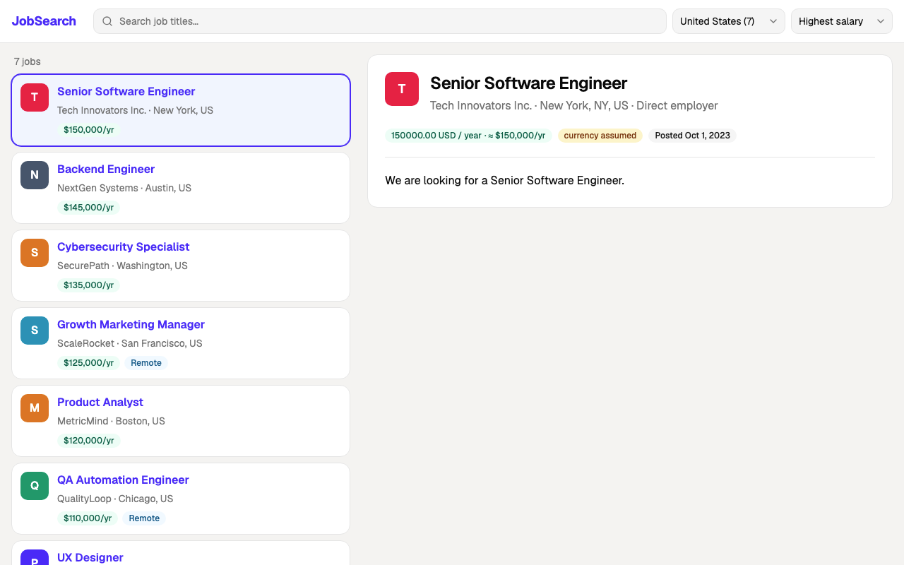
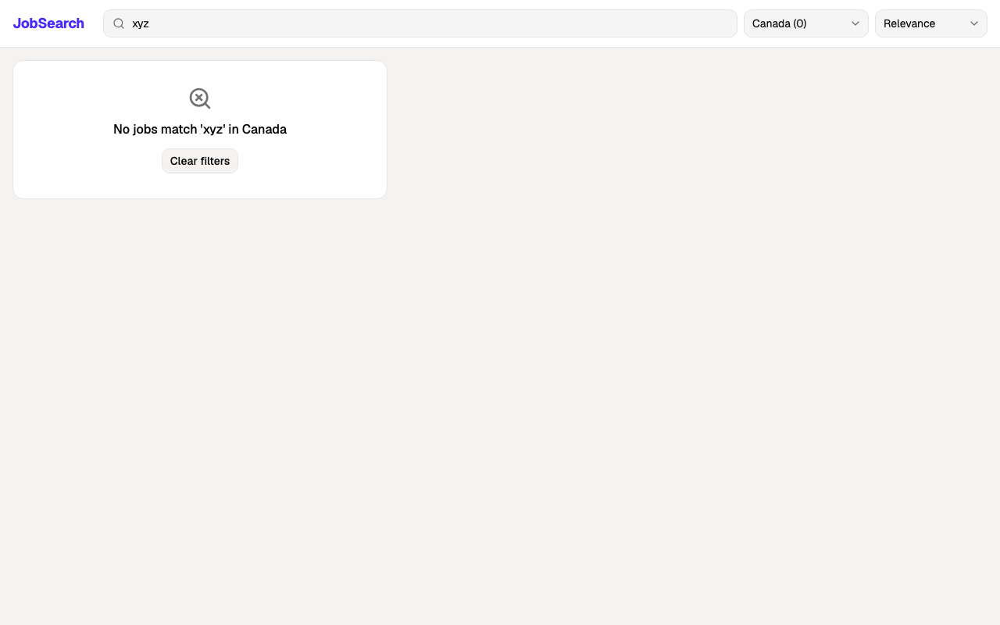
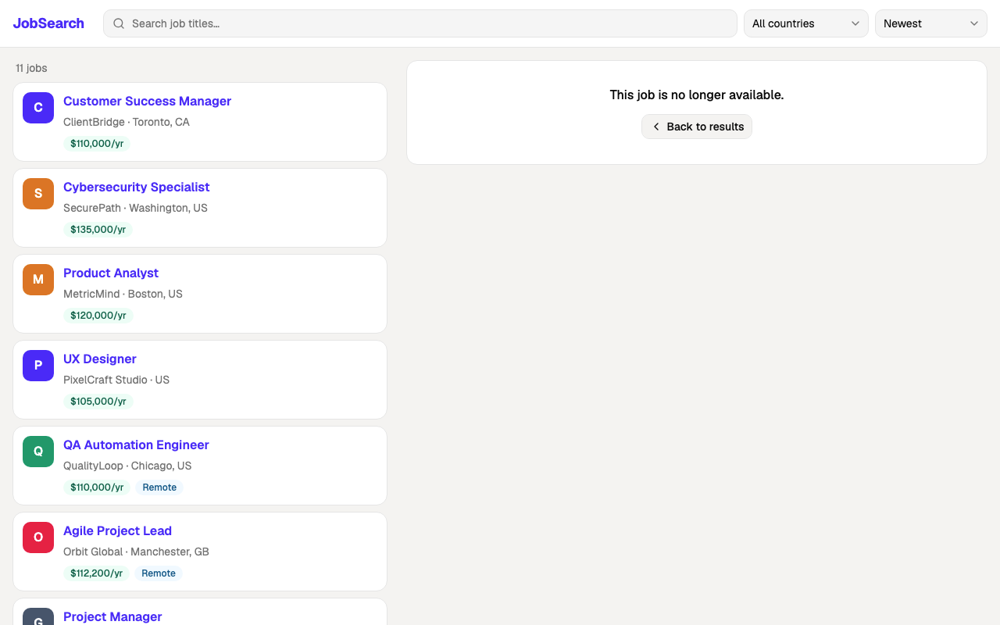
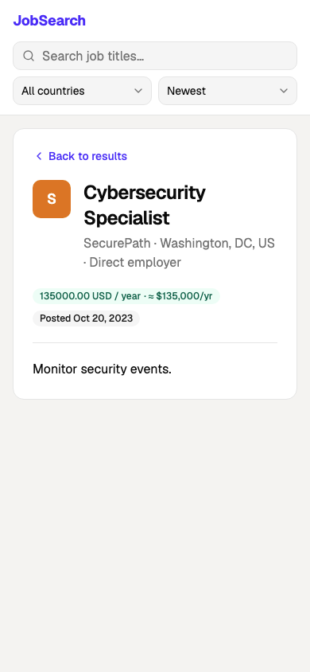

# Decisions

The brief's approval rules leave gaps that the sample feed hits. This page records how each
gap is closed and what is still open, followed by the stack and design choices behind the code.

## Decisions and assumptions

- **A bare salary number takes the local currency of the job's country.** Scraped Canadian
  postings are quoted in CAD, so a bare `62.5` in Montreal is CAD. A job with no country has
  no currency to infer and is rejected `salary_currency_unknown`.
- **A bare salary number's unit comes from its size.** Below 1,000 is hourly; 20,000 and above
  is annual. Anything in between could be weekly or monthly, so it is rejected
  `salary_unit_ambiguous` instead of guessed.
- **An explicit unit must fit the amount.** `hourly`, `hour`, `hr`, `h`, `per hour` and
  `annual`, `annually`, `yearly`, `year`, `yr`, `per year`, `per annum` are understood. An
  explicit hourly amount of 1,000 or more, or an explicit annual amount below 1,000, is rejected
  `salary_unit_ambiguous` (detail e.g. `150000 hourly`). Any other unit (e.g. `monthly`) is
  rejected `salary_unit_ambiguous` too, with the amount as the detail.
- **An explicit currency must be one we convert** (USD, CAD, GBP, EUR, PLN). Anything else is
  rejected `salary_currency_unknown` with the code as the detail. A salary object with no or
  `null` `value` is `salary_missing`; a quoted number is `salary_invalid`.
- **Salaries are decided at stored precision.** The amount is rounded to cents (half away from
  zero, as Postgres `numeric` does) before it is converted, and the converted USD value is
  rounded again before the comparison. The decision is about the salary as stored, so a stored
  approved salary is always above the threshold: 34.0949 GBP/h is stored as 34.09 GBP, which is
  44.9988 USD/h, or 45.00 after rounding, and is rejected.
- **Hourly pay is compared as hourly.** The thresholds are `> $45/h` and `> $100,000` a year.
  Hourly pay is never annualised for the decision (45 × 2080 = 93,600 would not line up with
  100,000); annualising is only used as a sort key.
- **Comparisons are strict.** "Over" and "above" mean `>`, so exactly $100,000 fails.
- **Remote means anywhere.** The US/Canada restriction applies only to in-person jobs. A remote
  job listed in the UK passes the location rule and the salary rule decides it. A remote job
  with `location: null` also passes.
- **`"CA"` after a city is California.** The country is read only from the last location
  segment or the explicit `country` field, and a two-part location ending in a US state code
  is that state. `"Washington, DC"` resolves to the US.
- **A consulting agency is not a staffing firm.** Company type is an enum and the excluded set
  (`DefaultRules(posting.StaffingFirm)`) is configurable; only `staffing_firm` is excluded.
- **Language is detected from the description.** The declared `language` field is used only
  when detection is unreliable (lingua's top two languages are closer than its minimum relative
  distance of 0.1). English is allowed
  everywhere; French only in Canada.
- **Currency conversion uses a static table** (`backend/internal/fx/static.go`), so decisions
  are reproducible: USD 1, CAD 0.70, GBP 1.32, EUR 1.11, PLN 0.25 (USD per unit). Two sample
  records sit near a threshold and depend on it:
  - Data Scientist: `62.5 CAD/h × 0.70 = 43.75 USD/h ≤ 45`, rejected. At 0.73 it would pass.
  - Project Manager: `80,000 GBP × 1.32 = 105,600 USD > 100,000`, approved. At 1.25 it would
    be exactly 100,000 and fail.
- **An empty `posting_date` becomes null.** The job is still approvable and sorts last in both
  date directions. `YYYY-MM-DD` and RFC 3339 timestamps (the date in their own offset) are
  read; any other date also becomes null and is logged as `job.date_invalid`.
- **Declared languages** are read by English name or ISO code for all eight detected languages,
  ignoring a region subtag (`en-US`, `pt_BR`).
- **"Remote" as a location segment** (`"Remote, USA"`, `"Toronto, Remote"`) marks the job
  remote and is dropped from the location. A lone US state code left after it (`"Remote, NY"`,
  `"Remote, CA"`) is that state.
- **Every failing rule is reported,** not only the first, so a rejection explains itself.
- **The remote-UK market from the brief's future hint is one policy entry.** See
  [Adding the remote-UK market](../backend/README.md#adding-the-remote-uk-market).

## Open questions

These are choices the brief does not settle. Each has an answer in the code, stated here
rather than guessed silently.

1. **Should a bare salary be read in the local currency or in USD?** Local currency (above).
   This decides Data Scientist and Project Manager: read as USD, Data Scientist is approved and
   Project Manager is rejected.
2. **Do consulting agencies, recruiters and executive search firms count as staffing firms?**
   Consulting agencies do not. The set is configurable.
3. **Are fixed exchange rates acceptable?** Yes, for this exercise. With live rates,
   re-evaluating stored postings should be a deliberate operator action, not a side effect of
   a rate moving (see the [production path](architecture.md#production-path)).
4. **Is a bilingual Canadian description acceptable if its dominant language is English or
   French?** Yes.

## Tech stack

The brief asks for Go (or typed Python) and React with TypeScript. The rest:

| Choice                                                | Instead of                                                    | Why                                                                                                                                                                                                                                                                                                                                                                                                                                                                                                                   |
| ----------------------------------------------------- | ------------------------------------------------------------- | --------------------------------------------------------------------------------------------------------------------------------------------------------------------------------------------------------------------------------------------------------------------------------------------------------------------------------------------------------------------------------------------------------------------------------------------------------------------------------------------------------------------- |
| Postgres                                              | MariaDB, MySQL                                                | The pipeline leans on Postgres features: `INSERT … ON CONFLICT … DO UPDATE … WHERE content_hash IS DISTINCT FROM … RETURNING id` returns no row for an unchanged posting, which is how re-ingestion counts `unchanged` in one statement; a partial index keeps the pending outbox scan small; `jsonb` holds the normalized posting and the rejection reasons; `squawk` lints migrations for locking problems and supports only Postgres. MySQL has no `RETURNING`, and neither MySQL nor MariaDB has partial indexes. |
| Elasticsearch                                         | Typesense, Meilisearch, OpenSearch, Postgres full-text search | The most mature and production-proven of the options: typo-tolerant search-as-you-type, facets, sorting with missing values last, aliases for reindexing without downtime, horizontal scaling, external versioning for safe replays from the outbox, and an official typed Go client.                                                                                                                                                                                                                                 |
| gin                                                   | chi, gorilla/mux, the standard `ServeMux`                     | With two routes the router barely matters. gin is the most widely known, `oapi-codegen` generates a gin server from the contract, and its recovery hook and per-request error list give problem+json panics and one log line per request with little code. chi would have worked equally well. gorilla/mux adds nothing over the method and wildcard patterns `ServeMux` has had since Go 1.22.                                                                                                                       |
| `pgx/v5` + `sqlc`                                     | GORM, ent, sqlx                                               | Queries are plain SQL checked against the migrations (`sqlc vet`, `sqlc diff` in CI) and compiled to typed Go; no ORM decides the SQL.                                                                                                                                                                                                                                                                                                                                                                                |
| goose                                                 | golang-migrate, Atlas                                         | Plain SQL files embedded into the binary and run by `cmd/migrate` as a separate step, never on application start.                                                                                                                                                                                                                                                                                                                                                                                                     |
| OpenAPI 3.0.3 + `oapi-codegen` + `openapi-typescript` | Hand-written handlers and types                               | One contract generates the Go server interface and the TypeScript types, and requests are validated against it before a handler runs. CI fails when either generated side is stale.                                                                                                                                                                                                                                                                                                                                   |
| `lingua-go`                                           | whatlanggo, a language API                                    | Accurate on short texts, runs offline, and reports how confident it is, which the policy uses to fall back to the declared language.                                                                                                                                                                                                                                                                                                                                                                                  |
| Outbox table + polling worker                         | Writing to Elasticsearch from `ingest`, Kafka                 | A posting and its outbox row commit in one transaction, so the index can never miss or invent a posting, without running a broker. Change data capture is on the [production path](architecture.md#production-path).                                                                                                                                                                                                                                                                                                  |
| Vite + React + TanStack Router and Query              | Next.js, Redux                                                | A client-only SPA needs no server rendering, and with the URL and the query cache holding all state (see [Frontend](#frontend)) there is nothing left for a global store.                                                                                                                                                                                                                                                                                                                                             |

## Updates and duplicates

### Updates to a posting

Feeds have no stable job id, so a posting's identity is derived from its fields: source,
company, title, location and posting date (the exact rule, and what happens to repeated elements inside one feed, are in
[re-ingesting a feed](../backend/README.md#re-ingesting-a-feed)). A second field, the content
hash, covers the whole raw record plus the policy version.

- **Same identity, same content:** nothing is written.
- **Same identity, changed content** (salary, description, employment type, …): the stored
  posting is updated in place, keeps its id, is re-approved, and the outbox re-indexes it
  under the same document id. Search never shows two versions.
- **The posting date stays the same through an update,** because it is part of the identity.
  A feed that re-sends a job with a new date is treated as a new posting: a repost is
  indistinguishable from a new opening without a source id, and keeping the date in the key
  means "Newest" sorts on the date the source published. The cost is a duplicate for every
  repost; `ingested_at` keeps the first time a posting was seen, while `decided_at` moves on
  each update.
- **Edited title, company or location** also creates a new posting, and the old one stays
  searchable until retraction exists (see
  [known limitations](architecture.md#known-limitations)).

Once a source sends a stable job id, it should replace the derived identity: the id becomes
the key, and title, location and date become ordinary updatable fields.

### Duplicates across sources

The source is part of the identity, so the same job scraped from two boards is stored and
listed twice. That is deliberate for now: matching across sources is fuzzy ("Acme Inc." vs
"ACME", "Toronto, ON" vs "Toronto, Canada"), and a wrong merge hides a real job, which is worse
than showing one twice.

The path when it matters: compute a canonical key (normalized company, title, city and
country, without the source) for each posting, keep a `job_groups` table that links postings
to one canonical job with a preferred source, and index one document per group. A cheaper
first step is Elasticsearch `collapse` on the canonical key at query time, which hides
duplicates in results without changing storage.

## Frontend

- **Split view.** The job list sits on the left and the selected job's detail on the right,
  with search, country and sort on top, so a reader can scan results without losing their
  place. The detail shows the job in the URL or, when none is selected, the first result.
  Below the `lg` breakpoint the page shows one column: the list, or the selected job with a
  link back to the results.
- **The URL is the only UI state.** Query, country, sort, page and selected job live in the
  query string and are parsed by one schema (`frontend/src/routes/jobsSearch.ts`), so every
  view can be shared, survives a reload and works with back/forward. A hand-edited value that
  fails the schema falls back to its default instead of sending an invalid request. Changing
  the query, country or sort resets the page and clears the selected job.
- **A plain `URLSearchParams` serializer.** TanStack Router's default runs `JSON.parse` on
  every value, so `?q=123` would arrive as a number and values would be JSON-quoted in the
  address bar. Every parameter is a scalar string, so the plain serializer gives readable URLs
  (`?q=C%2B%2B&country=CA`) and string values only.
- **The list comes from Elasticsearch and the detail from Postgres;** see
  [system flow](architecture.md#system-flow). The UI renders what the API returns and never
  filters, sorts or searches on its own.

### Search UX cases covered

The UI tests are in `frontend/src/routes/` and `frontend/src/lib/`. Prefix and typo matching,
facet counts and sort order are search behaviour, covered by the backend tests against
Elasticsearch.

| Case                    | Behaviour                                                                                         |
| ----------------------- | ------------------------------------------------------------------------------------------------- |
| All jobs                | Empty query lists every approved job, newest first; a job without a date says "Date not provided" |
| Search by title         | Debounced at 250 ms, prefix and typo-tolerant (`enginer` finds Engineer), matches highlighted     |
| Filter by country       | Options and counts come from the facets of the current query; "All countries" resets              |
| Sort                    | Salary by its USD equivalent, date in both directions; missing values last                        |
| Combined state          | Query, country, sort, page and job in the URL; reload and back/forward restore the view           |
| Loading                 | Skeletons; the previous results stay visible while the next page or query loads                   |
| Empty                   | "No jobs match 'xyz' in Canada", with a "Clear filters" button when a query or country is set     |
| Error                   | A failed first load shows the problem `detail` with Retry (a 4xx is not retried, a 5xx is retried twice); a failed refetch keeps the previous results |
| Job no longer available | A selected job that is not approved (404) says so and links back to the results                   |
| Pagination              | Resets to page 1 on a new query or filter; a page past the end links to the last page             |
| Accessibility           | Labelled search input and select, result count announced with `aria-live`, results are links      |
| Edge input              | `C++ & 100%` reaches the API intact; malformed URL values fall back to defaults                   |

|                                                                              |                                                                                          |
| ---------------------------------------------------------------------------- | ---------------------------------------------------------------------------------------- |
|  |    |
|              |                        |
|           |  |
